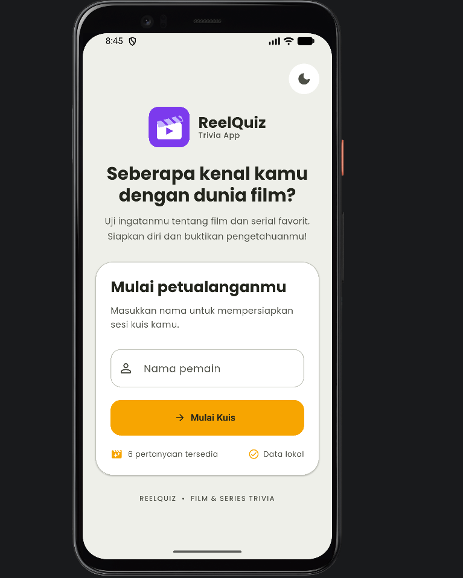
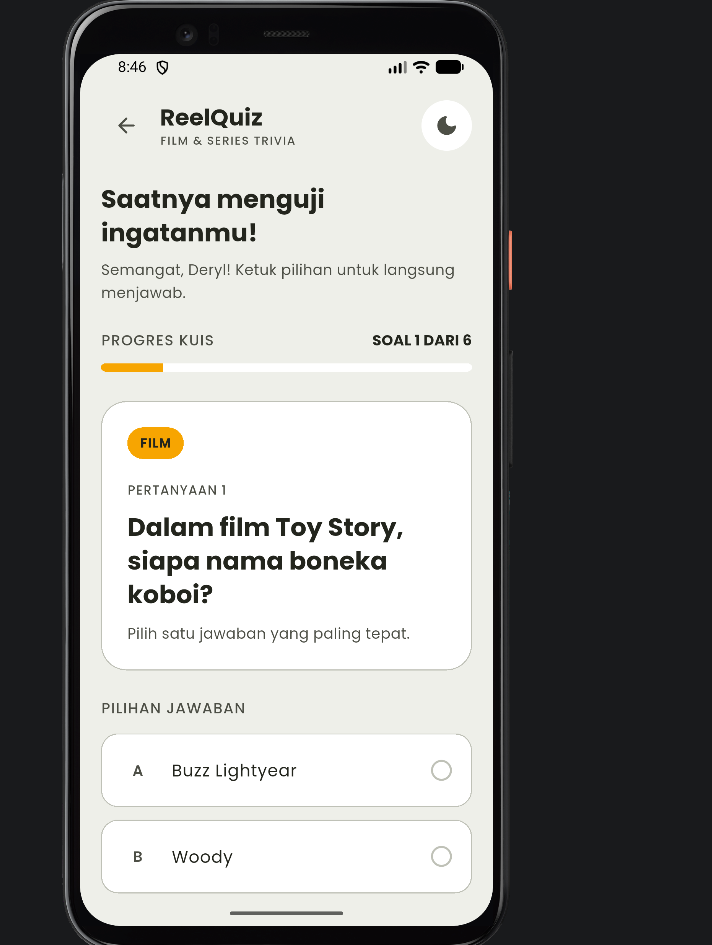
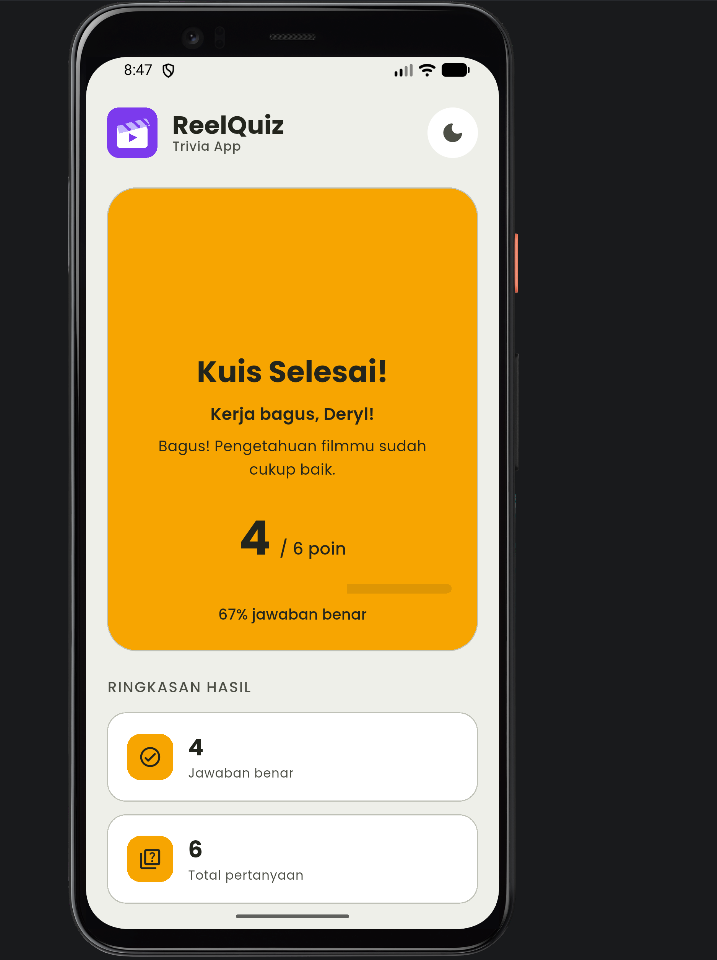

# ReelQuiz – Aplikasi Kuis Film & Series Trivia

---

## 👤 Identitas Mahasiswa

| | |
|---|---|
| **Nama** | Deryal Rasky |
| **NIM** | 241401120 |
| **Lab** | LAB 6 Pemrograman Mobile |

---

## 📱 Informasi Aplikasi

### Nama Aplikasi
**ReelQuiz** – Film & Series Trivia

### Deskripsi Singkat
ReelQuiz adalah aplikasi kuis trivia film dan serial berbasis Flutter yang dirancang untuk menguji wawasan pengguna mengenai dunia perfilman. Aplikasi ini dilengkapi dengan pilihan ganda reaktif dengan penilaian instan, statistik hasil kuis dan tingkat akurasi, tampilan responsif di berbagai ukuran layar (mobile, tablet, dan desktop), mengusung bahasa desain **PostHog Cream & Warm Canvas Design System**, serta mendukung *Dark Mode* & *Light Mode*.

### Fitur-Fitur yang Tersedia

#### Fitur Utama
- **Input Identitas Peserta** — Pengguna mengisi nama lengkap sebelum memulai sesi kuis
- **Kuis Pilihan Ganda Interaktif** — Soal trivia bertema film dan serial dengan opsi A–D
- **Penilaian Jawaban Instan** — Saat pengguna mengetuk opsi jawaban, sistem langsung memberikan umpan balik visual benar/salah secara real-time
- **Statistik & Hasil Akhir** — Menampilkan skor akhir, jumlah jawaban benar, total pertanyaan, dan persentase akurasi di halaman hasil
- **Dark Mode & Light Mode** — Toggle beralih tema terang/gelap tersedia di semua halaman via tombol di header

#### Fitur Tambahan & UI/UX
- **PostHog Design System** — Menggunakan palet warna warm cream canvas (`#EEEFE9`), PostHog yellow-orange CTA (`#F7A501`), dan tipografi modern
- **Responsif Multi-Platform** — Layout adaptif untuk smartphone, tablet, dan web/desktop menggunakan helper `Responsive`
- **Animasi Transisi & Kartu Reaktif** — Transisi halus dan kartu opsi dengan animasi perubahan status

---

## 📂 Struktur Proyek

```
lib/
├── core/
│   ├── theme/
│   │   └── app_theme.dart          # Kumpulan tema Light & Dark (PostHog Design System)
│   └── utils/
│       └── responsive.dart         # Helper responsivitas layar (mobile, tablet, desktop)
├── data/
│   └── quiz_questions.dart         # Daftar pertanyaan trivia film & series
├── models/
│   └── quiz_question.dart          # Model data soal & opsi jawaban
├── providers/
│   ├── quiz_provider.dart          # State management kuis, skor, & navigasi soal
│   └── theme_provider.dart         # State management tema (Dark / Light mode)
├── screens/
│   ├── home_screen.dart            # Halaman awal (input nama & tombol mulai)
│   ├── quiz_screen.dart            # Halaman kuis pilihan ganda & umpan balik instan
│   └── result_screen.dart          # Halaman hasil kuis, statistik akurasi, & skor akhir
├── widgets/
│   ├── app_logo.dart               # Logo & branding aplikasi ReelQuiz
│   ├── app_text_field.dart         # Input text field untuk nama pemain
│   ├── primary_button.dart         # Tombol utama bergaya PostHog CTA
│   ├── quiz_option_card.dart       # Kartu pilihan jawaban kuis (A-D) dengan status benar/salah
│   ├── result_stat_card.dart       # Kartu statistik ringkasan hasil kuis
│   └── theme_toggle_button.dart    # Tombol toggle dark/light mode
├── app.dart                        # Konfigurasi MaterialApp & Routing
└── main.dart                       # Entry point aplikasi & MultiProvider setup
```

---

## 🚀 Cara Menjalankan Aplikasi

### Prasyarat
- Flutter SDK `^3.13.3`
- Dart SDK
- Emulator Android / iOS, browser Chrome, atau Windows desktop

### Langkah

```bash
# 1. Clone repository atau buka direktori proyek
cd uts_pemrograman_mobile_deryal

# 2. Install dependencies
flutter pub get

# 3. Jalankan di emulator mobile / perangkat
flutter run

# 4. Jalankan di browser (web)
flutter run -d chrome

# 5. Jalankan di Windows desktop
flutter run -d windows
```

---

## 🖼️ Screenshot Aplikasi

### Halaman Beranda (Home Screen)


### Halaman Kuis (Quiz Screen)


### Halaman Hasil Kuis (Result Screen)


---

## 🎨 Dokumentasi

### Credit Aset
| Aset | Sumber |
|---|---|
| Ikon & Logo Film Reel (`film_reel.svg`) | PostHog Design System & Material Symbols |
| Font **Poppins** | [Google Fonts](https://fonts.google.com/specimen/Poppins) – SIL Open Font License |
| Ikon Material | [Material Symbols](https://fonts.google.com/icons) – Apache License 2.0 |
| Framework & Library | [Flutter](https://flutter.dev) & [Provider](https://pub.dev/packages/provider) |

### Link Mockup / Prototype
> [LINK CANVA PROTOTYPE APLIKASI](https://canva.link/d7tah77bh0bknxv)

### Link Video Presentasi
> [LINK GDRIVE VIDEO PRESENTASI](https://drive.google.com/drive/folders/1CGRCIISAKz4aGRRiZNCkxsXrGC4ZZzRR?usp=drive_link)

---

## 🔄 Alur Kerja Aplikasi

```
Halaman Beranda (Home Screen)
    ├── Isi Nama Pemain
    ├── Pilih Tema (Dark / Light Mode)
    └── Tap "Mulai Kuis"
            └──► Halaman Kuis (Quiz Screen)
                    ├── Pilih Jawaban (A, B, C, D) ──► Evaluasi Instan (Benar/Salah)
                    └── Tap "Soal Berikutnya" / "Lihat Hasil Kuis"
                            └──► Halaman Hasil (Result Screen)
                                    ├── Lihat Total Skor & Akurasi (%)
                                    └── Tap "Main Lagi" atau "Kembali ke Beranda"
```

---

## 🧰 Teknologi yang Digunakan

| Teknologi | Keterangan |
|---|---|
| **Flutter** | Framework UI cross-platform |
| **Dart** | Bahasa pemrograman |
| **Provider** | State management untuk kuis, skor, dan tema |
| **PostHog Design System** | Bahasa desain UI (Cream Canvas `#EEEFE9` & Yellow CTA `#F7A501`) |
| **LayoutBuilder / Responsive** | Deteksi ukuran layar untuk responsivitas adaptif |

---

*UTS Pemrograman Mobile – LAB 6 Pemrograman Mobile – Fasilkom-TI USU – 2026*
